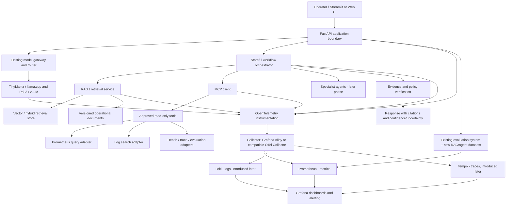

# Sprint 16 — Enterprise Agentic AI Platform Foundation
## Requirements and Architecture Specification (Draft v0.1)

**Project:** Enterprise AI Platform (EAP)
**Target use case:** Enterprise AI Platform Operations Copilot
**Status:** Review draft — not yet committed to the repository
**Baseline branch:** `phase-15-llm-evaluation`
**Working branch:** `feature/enterprise-agentic-platform`
**Baseline commit:** `5500073`
**Date:** 2026-10-23

---

## 1. Purpose

Evolve the existing Enterprise AI Platform into a production-oriented, observable agentic AI application while preserving the existing inference, routing, evaluation, CI/CD and observability capabilities.

The platform will demonstrate practical engineering across model serving, RAG, agent workflows, MCP tools, multi-agent investigation, evaluation, security, FinOps, TechOps and AIOps. The work must be delivered in small, testable phases, and use GPU resources only when real model behaviour must be measured.

This document is a proposed target specification. It does not state that the planned components are implemented or production-certified.

## 2. Current baseline

### 2.1 Repository and Git state

- Public repository: `https://github.com/pnrajeshkumar26/Enterprise-AI-Platform`
- Local development branch: `feature/enterprise-agentic-platform`
- Parent branch: `phase-15-llm-evaluation`
- Starting commit: `5500073` (`Sprint 15 - Finalize LLMOps and evaluation documentation`)
- `origin/phase-15-llm-evaluation` points to the same commit.
- The remote `origin/main` reference points to merge commit `2ba4547`, which includes Sprint 15. Do not switch, reset, merge or pull solely to update the local `main` branch during this work.
- Preserve the pre-existing local change to `docs/troubleshooting/TROUBLESHOOTING-002-Dynamic-Model-Registry-Integration.md`. Do not accidentally include it in Sprint 16 commits.

### 2.2 Verified test baseline

Two existing test commands were run separately on the development workstation:

| Suite | Result |
|---|---:|
| `PYTHONPATH=services/runtime-api; python -m pytest -q tests` | 86 passed, 3 skipped, 2 warnings |
| `PYTHONPATH=.; python -m pytest -q evaluation/tests` | 36 passed |
| **Observed combined baseline** | **122 passed, 3 skipped, 2 warnings** |

The warnings were Starlette deprecation warnings concerning `HTTP_422_UNPROCESSABLE_ENTITY`; they did not fail the runtime tests. Re-run both commands at relevant milestones. These counts are a historical baseline, not a guarantee that later commits pass.

### 2.3 Existing capabilities confirmed by repository review

- FastAPI Runtime API and Streamlit frontend.
- TinyLlama through llama.cpp and Phi-3 through vLLM.
- Model registry, capacity checks, deterministic/multi-signal model routing and backend health metrics.
- Prometheus metrics for requests, latency, failures, tokens, estimated self-hosted inference cost, routing outcomes and backend state.
- NVIDIA DCGM Exporter configuration for GPU telemetry.
- Prometheus and Grafana Compose files, a provisioned dashboard and runtime alert rules.
- Offline evaluation dataset, deterministic metrics, LLM-as-a-Judge, benchmark report, evaluation exporter and quality gate.
- GitHub Actions test/build workflow and a manually triggered evaluation quality gate.
- Docker-based deployment and restart-recovery documentation.

### 2.4 Capabilities to validate or add

The repository filename inventory did not reveal an end-to-end implementation for:

- OpenTelemetry request/workflow tracing and trace-to-log correlation.
- Centralized application log collection with searchable trace correlation.
- RAG ingestion, embeddings, retrieval, citations and retrieval-quality evaluation.
- Stateful agent/workflow orchestration.
- MCP client/server integration and tool-level policy enforcement.
- Multi-agent delegation and supervision.
- Persistent agent session/memory lifecycle.
- Workflow-level service objectives, outcome accounting and unit economics.
- Complete operational dashboards for agents, RAG, MCP, evaluation, FinOps, AIOps and governance.

These are audit findings from the inspected public/local branch file inventory; they must be checked against actual source behaviour before implementation. Do not infer implementation status from filenames alone.

## 3. Product vision and primary use case

### 3.1 Product

**Enterprise AI Platform Operations Copilot** — an assistant that helps an operator investigate service health, performance degradation, model-backend failures, cost changes and evaluation regressions using approved enterprise evidence.

### 3.2 Example user journey

An operator asks: “p95 latency increased and some requests are failing. Investigate the likely bottleneck, find the relevant runbook, estimate impact, and recommend next steps.”

The application should:

1. Validate the user's request and permissions.
2. Create a session and workflow correlation context.
3. Retrieve relevant runbooks and architecture documentation with citations.
4. Query only approved metrics, logs, health endpoints or trace summaries using controlled tools.
5. Use a bounded workflow to gather evidence and check whether it is sufficient.
6. Optionally delegate bounded subtasks to specialist agents in a later phase.
7. Verify consistency between the evidence and the final response.
8. Return findings, evidence, uncertainty, recommended next actions and an incident summary.
9. Record the technical workflow outcome separately from AI answer quality.
10. Record latency, token usage, cost estimates, tool calls, failures and trace context without putting sensitive payloads into metric labels.

Initial operations are **read-only**. State-changing actions remain out of scope until permission design, audit and human-approval gates are implemented and tested.

## 4. Scope

### In scope

- Preserve and extend the current FastAPI/model-gateway platform.
- Define a telemetry contract and request/workflow correlation model.
- Instrument traces, structured logs and metrics across the request lifecycle.
- Build an operational RAG knowledge pipeline with citations and access-aware retrieval.
- Expose selected read-only operational functions through MCP.
- Implement a single-agent, stateful and bounded workflow before multi-agent collaboration.
- Add agentic RAG only when baseline RAG results justify its complexity.
- Add a supervisor plus specialist agents after single-agent and tool use are reliable.
- Extend evaluation and CI quality gates for retrieval, tool use, task completion, grounding and safety.
- Implement FinOps, TechOps, AIOps, AI-quality and security/governance views.
- Validate failure injection, alert lifecycle, recovery, security boundaries and cost controls.
- Use CPU-first development and limited, scheduled GPU sessions.

### Out of scope for the initial sprint

- Replacing the current model router or inference backends without evidence that this is necessary.
- Running all components continuously on the 3 GB RAM VirtualBox VM.
- Unrestricted shell access or autonomous production changes by an agent.
- Deploying every proposed observability component at once.
- Claiming production readiness, SLA compliance, autonomous remediation or statistically strong model quality before the relevant controls have been validated.
- Adding Kubernetes, Temporal, multiple vector stores, or several agent frameworks merely to expand the technology list. Add these only when a requirement and acceptance test justify them.

## 5. Target logical architecture

This diagram is a target-state design, not the current deployment. Existing Prometheus/Grafana components should be retained where practical; Loki, Tempo and the collector will be introduced incrementally. Service-specific exporters and collection paths may remain where they are more appropriate.

## 6. Proposed architecture decisions

| ID | Decision | Rationale / guardrail |
|---|---|---|
| ADR-001 | Keep FastAPI and the existing model gateway as the stable application/inference boundary. | Avoid rewriting the proven runtime and routing implementation. |
| ADR-002 | Add OpenTelemetry tracing and context propagation before building complex agent flows. | Every later model, retrieval, agent and tool span should inherit a consistent trace context. |
| ADR-003 | Retain Prometheus/Grafana initially; add logs/traces backends incrementally. | Reduce change scope and resource pressure; do not install a full observability stack in one step. |
| ADR-004 | Start with one stateful workflow implementation (proposed: LangGraph). | Make state, branching, retries, timeouts, approval and completion semantics explicit. Do not add a second orchestrator without a clear durable-workflow requirement. |
| ADR-005 | Start RAG with one vector/retrieval store (proposed: Qdrant) and a versioned corpus. | Keep ingestion and retrieval reproducible; choose hybrid retrieval/reranking based on benchmark evidence. |
| ADR-006 | Use MCP for a small, explicit tool catalogue. | Start with read-only metrics, log search, health and evaluation tools; validate input/output schemas and authorization. |
| ADR-007 | Add agentic RAG and multiple agents only after a baseline single-agent/RAG implementation exists. | Compare against simpler baselines on task success, groundedness, latency, tool calls and cost. |
| ADR-008 | Separate technical workflow completion from AI task-quality success. | A successful HTTP response or completed workflow does not necessarily mean a correct/helpful answer. |
| ADR-009 | Avoid high-cardinality or sensitive Prometheus labels. | Do not use trace/session IDs, raw prompts or arbitrary tool arguments as metric labels; keep protected details in traces/logs with appropriate retention/access. |
| ADR-010 | CPU-first build/test, with controlled GPU experiments. | Do not pay for idle GPU time; reserve GPU for real model serving, throughput, VRAM and selected end-to-end evaluation runs. |

These ADRs are proposed; record any changes and rationale as implementation evidence is gathered.

## 7. Functional requirements

| ID | Requirement | Acceptance evidence |
|---|---|---|
| FR-01 | Preserve existing generation, model discovery, routing and health interfaces unless a backward-compatible change is explicitly designed. | Existing runtime/integration tests pass; API contract changes are documented. |
| FR-02 | Every copilot request receives a correlation context that is propagated across application, workflow, model, RAG and tool operations. | A sampled end-to-end trace can be opened and followed across all implemented spans, including error paths. |
| FR-03 | The knowledge ingestion pipeline records source, version, ingestion result and index metadata. | Repeatable ingestion run; counts for success/failure; stale or failed documents are visible. |
| FR-04 | RAG responses include source citations and can return insufficient evidence rather than inventing a source. | Versioned tests for relevance, citation correctness, grounding and abstention. |
| FR-05 | MCP tools have explicit schemas, names, descriptions, timeouts and permission policies. | Tool catalogue tests, invalid-input tests, authorization-denial tests and audit records. |
| FR-06 | Workflow execution has explicit state and bounded steps, retries, iteration count, elapsed time and budget. | Tests for success, tool error, timeout, cancellation, rejection and maximum-budget exhaustion. |
| FR-07 | Multi-agent execution is supervised and constrained. | Specialist ownership, handoff contracts, state limits, parallelism bounds and independent verification tests. |
| FR-08 | Evaluation can measure retrieval quality, grounding, task completion, tool selection/use, safety and latency/cost tradeoffs. | Versioned dataset and repeatable benchmark report; quality gates are configurable and tested. |
| FR-09 | Workflow and agent metrics distinguish terminal outcomes: completed, failed, timed_out, cancelled, rejected and partial where applicable. | Tests confirm that each execution increments exactly one authoritative terminal outcome. |
| FR-10 | The system exposes operational dashboards and actionable alerts as capabilities mature. | Dashboard-as-code where practical; alert rule tests, notification evidence, recovery test and runbook. |
| FR-11 | Every recommended action is labelled as advisory unless an explicitly permitted action path is later approved. | UI/API response and policy tests; no direct production mutation in initial phases. |
| FR-12 | Releases carry enough version metadata to diagnose behaviour changes. | Correlate app release, prompt/version, model configuration, tool schema, dataset and RAG index version in trace/evaluation records. |

## 8. Non-functional requirements and guardrails

- **Reliability:** timeouts and bounded retries at external boundaries; no unlimited agent loops.
- **Performance:** measure baseline and p50/p95/p99 latency for request, workflow, retrieval, model and tool steps; set numeric SLOs only after baseline/load measurements and workload requirements are documented.
- **Security:** least privilege, input validation, secret-safe configuration, authorization at tool execution, prompt-injection tests, sensitive-data redaction and audited approvals.
- **Privacy:** don't store raw prompt/tool payloads by default in metric labels; define trace/log sampling, redaction and retention before enabling detailed production telemetry.
- **Cost:** configurable per-request and per-workflow token/call/time budgets; explicit model-cost and infrastructure-cost assumptions; clear distinction between estimates and provider-billed costs.
- **Maintainability:** version-controlled configs/dashboards/rules, documented schemas, automated tests, small changes and rollback path.
- **Portability:** local/CPU development should exercise application logic without requiring a GPU; GPU-specific tests are opt-in.
- **Observability reliability:** detect collector failures, dropped spans, metric gaps, scrape failures, ingestion lag and storage pressure.
- **Accessibility of outcomes:** show evidence, uncertainties, failed tool steps and recommendations clearly; avoid claiming confidence values are calibrated unless measured.

## 9. Telemetry contract v0.1

The following names are proposals, not assumed existing metrics. Inspect current metric definitions first and reuse or map existing measures wherever possible.

| Metric | Type | Low-cardinality dimensions / notes |
|---|---|---|
| `ai_workflow_runs_total` | Counter | `workflow`, `environment`, `outcome`, `release` |
| `ai_workflow_duration_seconds` | Histogram | `workflow`, `environment`; duration from start to terminal state |
| `ai_workflow_timeouts_total` | Counter | `workflow`, `timeout_category` |
| `ai_agent_invocations_total` | Counter | `agent`, `environment`, `outcome` |
| `ai_agent_duration_seconds` | Histogram | `agent`, `environment` |
| `ai_agent_iterations` | Histogram | `agent`, `workflow` |
| `ai_tool_calls_total` | Counter | `tool`, `server`, `outcome` |
| `ai_tool_duration_seconds` | Histogram | `tool`, `server` |
| `ai_rag_retrieval_duration_seconds` | Histogram | `retrieval_component`, `environment` |
| `ai_rag_retrieval_results` | Histogram | `retrieval_pipeline`, `environment` |
| `ai_guardrail_events_total` | Counter | `guardrail_type`, `outcome` |
| `ai_approval_requests_total` | Counter | `approval_type`, `outcome` |
| `ai_llm_tokens_total` | Counter | `provider`, `model`, `token_direction` |
| `ai_fallbacks_total` | Counter | `fallback_reason`, `target_model` |
| `ai_evaluation_results_total` | Counter | `evaluation_type`, `result_category`, `release` |

Metric contract rules:

1. Document definition, type, units, label set, reset behaviour, denominator and intended query for each accepted metric.
2. Do not place trace IDs, session IDs, user identifiers, raw prompts, document IDs with unbounded values or free-form tool arguments in Prometheus labels.
3. Store trace/span IDs in structured logs and traces, not metric dimensions.
4. Record one authoritative terminal workflow outcome per started workflow. Define how invalid requests and authorization rejections enter denominators.
5. Keep technical success separate from AI-quality success and safety-policy outcomes.
6. Treat local self-hosting cost as an infrastructure allocation estimate; don't label it as actual billed model cost.

### Proposed outcome definitions

- `completed`: workflow finished its defined technical steps.
- `failed`: an unhandled technical error prevented completion.
- `timed_out`: an explicit workflow or operation deadline expired.
- `cancelled`: execution was intentionally cancelled.
- `rejected`: request/policy validation prevented execution.
- `partial`: useful partial evidence was returned but the full workflow goal was not achieved; use only if the product supports it.

### Initial derived measures

- Workflow timeout rate = timed-out eligible workflows / eligible started workflows.
- Agent failure rate = failed agent invocations / attempted agent invocations.
- Task-quality success = completed responses passing the defined evaluation threshold / responses evaluated under that policy.
- Cost per successful task = allocated inference/agent/tool cost / completed tasks, with its denominator policy documented.
- Cost per quality-passing task = attributed cost / tasks that meet the required quality and safety gate.

## 10. Operational dashboard suite

These are nine linked logical views, not a requirement to fit everything onto one dashboard.

1. **Executive AI Service Overview:** SLO compliance, task completion, quality-passing rate, cost per successful task, budget and incidents.
2. **Platform and Inference TechOps:** API traffic/errors, p95/p99 latency, time to first token, throughput, CPU/RAM/disk/GPU/VRAM when available, queue pressure and backend health.
3. **Agent and Workflow Operations:** workflow outcomes, duration, plans, handoffs, retries, loops, parallel-branch waits, cancellations and approval latency.
4. **RAG and Knowledge Operations:** ingestion outcomes, index freshness, embedding/retrieval latency, hit count, reranking, context size, citations and grounding trends.
5. **MCP and Tool Operations:** discovery, invocation, latency, timeouts, schema errors, authorization denials, retries, rate limits and downstream failures.
6. **AI Quality and Evaluation:** correctness/grounding, relevance, citation accuracy, task completion, evaluation coverage and release regressions.
7. **LLMOps FinOps and Unit Economics:** token and model costs, GPU/infrastructure allocation, agent/tool usage, budget variance and cost per completed/quality-passing task.
8. **AIOps and Incident Management:** correlated alerts, change context, error-budget consumption, incident timelines, MTTD/MTTR, runbook links and recovery results.
9. **AI Security and Governance:** prompt-injection tests, redaction, policy denials, privileged tool requests, approval audit, retention and suspicious usage.

Every applicable view should drill from aggregate metric → workflow → agent/model/RAG/tool span → sanitized logs → runbook → recovery verification. Access control and redaction apply throughout.

## 11. Phase roadmap and exit criteria

### Phase 00 — Requirements and architecture (current)

**Deliverables:** requirements, target architecture, architecture decisions, telemetry contract draft, risk register, prioritised backlog and acceptance criteria.

**Exit:** scope boundaries, first use case, read-only security stance, cost strategy and phase order reviewed and accepted.

### Phase 01 — Baseline and repository safeguards

- Preserve the existing troubleshooting-document modification.
- Reconcile local branch and remote refs without unnecessary main-branch changes.
- Record runtime and evaluation test baselines.
- Verify current deployment/config contracts and map existing metrics, dashboards and alerts.
- Create feature-branch commit discipline and rollback approach.

**Exit:** baseline documented; existing relevant tests pass or all deviations are recorded; no unrelated file is included in a feature commit.

### Phase 02 — Observability and request correlation

- Instrument FastAPI request lifecycle with OpenTelemetry.
- Define trace context propagation and span boundaries.
- Add structured logging correlation; add collector and trace/log storage in resource-safe increments.
- Validate redaction/sampling and instrument the telemetry pipeline itself.

**Exit:** end-to-end trace and correlated logs for a runtime request; tested success/error paths; no sensitive or high-cardinality values in metrics.

### Phase 03 — Workflow/agent instrumentation foundation

- Establish the workflow state/outcome contract.
- Add bounded execution, retries, timeouts, cancellation and budget limits.
- Instrument model and tool calls through parent-child spans and low-cardinality metrics.

**Exit:** workflow outcome reconciles with individual operations; timeout and failure scenarios can be diagnosed from trace to logs.

### Phase 04 — RAG service

- Ingestion, chunking, embeddings, metadata, access filters, retrieval, citations and index versioning.
- Establish a representative versioned retrieval/answer evaluation dataset.

**Exit:** retrieval relevance and answer groundedness are measured; citations resolve to ingested sources; access controls and abstention behaviour are tested.

### Phase 05 — MCP tools

- Implement a small test MCP server/client and a typed tool catalogue.
- Begin with read-only metrics, health, logs, trace summary and evaluation tools.
- Add authorization, timeouts, output limits, audit and error handling.

**Exit:** tool discovery/calls, invalid schemas, unavailable tools, denials, retries and timeout behaviours are tested and traced.

### Phase 06 — Single-agent workflow and agentic RAG

- Use one stateful orchestrator with bounded branches and explicit evidence checks.
- Add query reformulation/retrieval retry only where justified.
- Compare RAG baseline against agentic RAG.

**Exit:** tests measure task completion, groundedness, tool correctness, latency and cost; complexity is retained only when it demonstrably improves the target task.

### Phase 07 — Multi-agent supervisor and specialists

- Introduce a supervisor and small set of roles (performance/TechOps, knowledge/RAG, FinOps/quality verification).
- Define handoffs, shared state, parallelism, aggregation, conflict handling and budget policies.
- Compare with single-agent baseline.

**Exit:** measurable gain on selected complex investigations without unacceptable cost, failure rate or unsupported claims.

### Phase 08 — Evaluation, safety and release governance

- Extend existing dataset/quality gate to RAG, tools, workflow outcome and agent safety.
- Correlate application, prompt, model, tool-schema, dataset and index versions.
- Add prompt injection, unauthorized tool invocation, redaction and regression tests.

**Exit:** representative automated evaluations run repeatably; policy-defined quality/safety regressions prevent promotion where intended.

### Phase 09 — Dashboards, FinOps and alerts

- Implement the nine linked operational views incrementally.
- Define metric denominators, SLO thresholds, error budgets and cost attribution.
- Test alert notifications, ownership, runbooks and recovery notifications.

**Exit:** dashboards reconcile with source telemetry; alert firing/recovery is demonstrated; estimates and actual costs are clearly distinguished.

### Phase 10 — Resilience, deployment and portfolio evidence

- Load/fault testing, capacity and storage review, recovery/rollback, security and access checks.
- Optional Kubernetes/Helm/Temporal/cloud validation when justified and budget-approved.
- Produce architecture diagrams, runbooks, benchmark reports and interview demonstration scripts.

**Exit:** repeatable deployment/recovery evidence, documented limitations, tested budgets and a portfolio narrative supported by measurements.

## 12. Sprint 16 proposed backlog

Sprint 16 is the foundation sprint; avoid implementing all agent features in one sprint.

| Item | Priority | Deliverable | Acceptance criteria |
|---|---|---|---|
| S16.1 Current-state baseline | P0 | Baseline record and existing-component inventory | Current branch/commit, working-tree changes and both test-suite results are recorded; troubleshooting document remains preserved. |
| S16.2 Requirements specification | P0 | Product use case, user stories, functional/non-functional requirements | Each requirement has an ID and verifiable acceptance criteria. |
| S16.3 Architecture and ADRs | P0 | Logical/deployment diagrams and decision records | Existing components are distinguished from proposed components; phase boundaries and resource assumptions are explicit. |
| S16.4 Telemetry contract | P0 | Metric/outcome/trace schema v0.1 | Definitions, labels, units, cardinality and denominator policies documented; existing metric names mapped. |
| S16.5 Security and cost model | P0 | Threat/risk register and resource plan | Read-only MCP starting policy, approval boundary, redaction, retention, local RAM limits and GPU spend policy documented. |
| S16.6 Implementation backlog | P1 | Ordered stories for observability, RAG, MCP, agents, evaluation and dashboards | Dependencies, testing approach and exit gates identified. |

Sprint 16 should not yet deploy Qdrant, LangGraph, MCP servers, Loki or Tempo to the user's existing environment. First review the specification and validate exact resource/dependency implications, then implement one component at a time on the feature branch.

## 13. GPU and resource plan

- Default to CPU/mocked model adapters for unit tests, orchestration, MCP, RAG plumbing, security tests and telemetry validation.
- Use the existing GPU-capable host only when available and practical; otherwise rent a GPU for a scheduled, measured session.
- Initial budget is provisional: target 5–10 GPU hours/month and a hard pre-approved ceiling (suggested starting cap: USD 15–20/month for GPU-related experiments). Confirm provider price, storage, bandwidth, taxes, automatic shutdown and persistent resource billing before use.
- Do not run the full stack continuously on the 3 GB VirtualBox VM. Use it only for small isolated experiments, or keep it stopped. Prefer the main development workstation for code/tests and only a resource-appropriate environment for integrated service runs.
- Track experiment purpose, start/stop time, instance/provider, unit price assumptions, storage charges and measured results.
- Stop/terminate GPU instances after each session and verify billable storage/resources separately.

## 14. Delivery controls

- No changes to stable `main` during initial development.
- Keep changes small and purpose-specific; update only selected files per commit.
- Run runtime and evaluation tests after relevant changes; add targeted tests for every new workflow/tool/retrieval capability.
- Store dashboard and alert configuration as code where supported.
- Record architecture decisions and failed experiments, not just successful outcomes.
- Do not claim that a component is implemented, tested, secure or production-ready until there is reproducible evidence.

## 15. Immediate next actions

1. Review this draft and confirm the initial use case and scope.
2. Inspect the modified troubleshooting document, but do not commit or rewrite it as part of Sprint 16.
3. Compare current working tree with `origin/main` and make a deliberate branch/version plan; do not pull or merge blindly.
4. Add the reviewed requirements/architecture document to the feature branch as a dedicated documentation change only after approval.
5. Begin Phase 02 implementation planning: instrument one FastAPI request end-to-end, starting with tracing context propagation and structured-log correlation.

---

**Status disclaimer:** This specification is a design draft. The implementation will be accepted phase by phase against tests, demonstrations and documented operational evidence.

## 14. Implementation status update - 2026-11-01

This update supplements the original baseline assessment and target-state
architecture. It records implementation evidence from the local development
environment; it does not indicate production readiness.

### Observability implementation completed locally

The following Runtime API observability capabilities have been implemented
and validated:

- OpenTelemetry instrumentation for incoming FastAPI HTTP requests.
- Outbound HTTP tracing through the Python requests instrumentation.
- OTLP trace forwarding through Grafana Alloy to Grafana Tempo.
- Trace and span context injection into Python application log records.
- Runtime API request-completion logging, excluding /metrics scrapes.
- Docker stdout/stderr log collection for the enterprise-runtime-api
  container through Alloy and delivery to Loki.
- Grafana provisioning for Loki and Tempo.
- Bidirectional trace/log navigation demonstrated for /health and /models.
- Runtime API regression tests and observability configuration validation.

Implementation evidence and reproduction procedures are documented in:

- docs/observability/PHASE-16.1-OPENTELEMETRY-TRACING.md
- docs/observability/PHASE-16.2-CENTRALIZED-LOGGING.md

### Current scope and limitations

The implementation is limited to the local Runtime API lab:

- Docker log collection currently targets only enterprise-runtime-api.
- Outbound instrumentation covers Python requests; other HTTP clients
  require their own instrumentation.
- Workflow, RAG, MCP, agent and model-serving components have not yet been
  instrumented as part of this work.
- Error-path trace/log correlation, log redaction, sampling policy and
  telemetry-pipeline health monitoring remain follow-on work.
- Loki currently uses local filesystem storage, unauthenticated lab access
  and a 72-hour retention setting.
- Alloy uses Docker socket access for container discovery and log collection.
  This is a privileged integration and requires a separate hardened design
  before production use.
- Prometheus scrape configuration was intentionally left unchanged.
- No production deployment, production security certification or cloud
  object-storage integration is claimed.

### Sprint 16 Phase 02 status

**Status: Partially implemented and locally validated.**

The Runtime API tracing and correlated logging path has been demonstrated
end to end. The broader observability exit criteria remain open until the
remaining instrumentation, security, error-path, sampling and operational
monitoring work is completed and validated.
